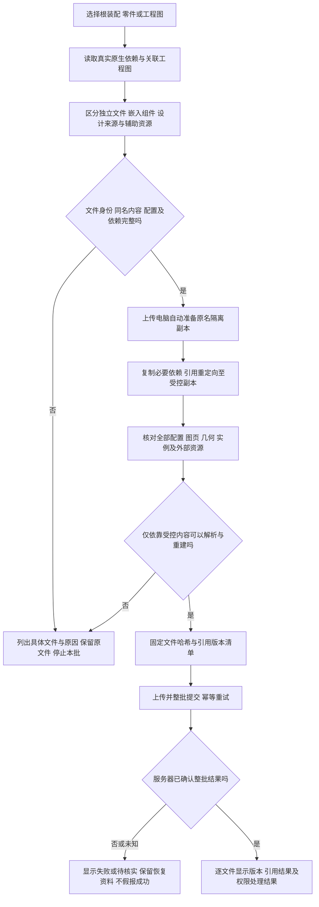
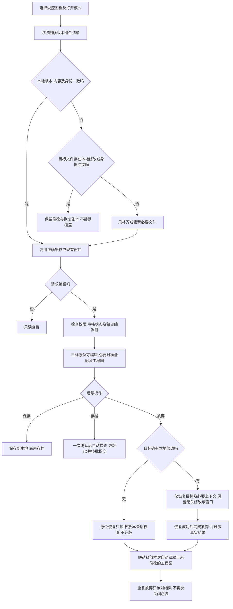

# SOLIDWORKS PDM 图档流程对照与修复建议

## 2026-10-26 23:53：旧 CopyDesignTemp 组件位置误判修复（234922）

用户 23:12 手动存档在 NativeArchiveManifest.Validate 被 8 项实际组件缺失拦截。逐文件确认 8 个原件均存在于 `F:\1`，包含带前导下划线的 `_GHR30R1000C+RC-20_20滑轨.SLDPRT`；旧 `F:\CopyDesignTemp` 均已不存在。原因是自动刷新使用只读扫描，保留压缩/轻量组件的旧保存地址，而存档准备也使用此扫描结果，在明确定位前就读取压缩结构和执行缺件检查。

新增仅在明确存档流程中执行的位置核对：显示树扫描返回后，以所属实际装配的原生解析结果、原生实例保存地址及同套目录定位现存文件；按所有者批量读取，恢复原工作目录。受控副本须符合项目及图档身份；多个目标、已存在的原地址和真实缺件不会被自动替换。失败时还原本次托管树路径修改。调用点覆盖选择列表建立前、正式准备时和压缩子装配读取后，保留原名、原引用记录、压缩状态和配置，不恢复后台自动加载。

基于并发已部署的项目确认界面版本 231811 合入，三处插件已更新为 **2026.10.26.234922**，保留 224354 的带引用提示存档能力，API 未改动。342 项针对性自动检查通过；8 个真实源文件部署前后哈希一致。实际整体存档仍由用户手动验证，未启动此前已停止的 11 项实机测试。

证据：`tmp/archive-file-location-publish-20261026/final-installed-verification.json`、`fix-evidence.json`、`locations-final.log`；真实文件核对为 `tmp/archive-file-location-20261026/real-source-evidence.json`。

## 2026-10-26 23:04：带引用提示存档已部署本机（224354）

用户已确认：自动补齐仍找不到旧导入源、智能关联源等文件时，允许保存现有原生图档，显示“存档成功（有引用提示）”，永久保留缺失记录和原有关联。此状态不等同全新电脑完整重建通过。

插件统一了补齐、提前检查和最终提交三个环节：缺失设计来源写入版本快照的 `ReferenceWarnings`；不登记不存在的原件，不把它当作 BOM 子件。未知嵌入归属、实际装配子件或工程图模型缺失、同名内容冲突、编辑权限和实际文件读写失败仍执行原有阻断。后续发现的来源目录会追加到同批搜索范围。链接 OLE 文件按来源收集，宏特征和内部内容未核实形成提示，普通检入不再强制固化或断链。

服务端使用原有版本引用 JSON 持久化提示，没有数据库结构变更；旧版本未带此字段时保持原有序列化结构。新增能力接口让插件在服务器不支持持久化提示时停止带提示提交。过程记录完整显示提示，版本记录显示数量并可查看来源路径和原因。原文件名、参数特征和原关联均保留。

冻结发布以本机已部署 212924 为基线，保留已有项目填充及其他修复。插件三处、API、Domain 版本为 **2026.10.26.224354**；Application、Infrastructure、运行配置保持本次发布前内容。256 项针对性自动检查通过，版本持久化/重复提交场景及使用实际候选 API、Domain 与既有 Application、Infrastructure 的隔离 HTTP 场景通过。API 健康、能力接口认证、三处插件哈希、PDB 源核对及界面同步/VerifyOnly 均通过；在线界面为 2026.10.26.223203。

11 项实机业务测试仍按用户要求停止，由用户手动验收。本次没有声称真实 224 份图档已整体存档成功，也没有声称此前打开闪退已通过实机复测。

证据：`tmp/reference-warning-20261026/final-installed-verification.json`、`fix-evidence.json`、`api-candidate-test.log`、`domain-test.log`、六组 `*-final.log`、`publish-result.json`。

## 2026-10-26：以成功存档为目标复核处理路径（方案，尚未实施）

本轮重新核对本机对应的 PDM 2022 官方帮助中检入、引用更新、缓存获取、用户/组警告、3D Interconnect、自定义引用、工程图带入、复制树，以及官方技术支持对首次检入缺失引用的说明。以下区分官方能力和建议的 UPLM 自动处理；不是宣称 PDM 会自动完成全部修复。

普通检入应首先保存本次选中的原生文件及可取得的关联文件。引用警告是否阻断是管理策略；它不应被多个无条件异常重新变成强制停止。完整设计包的验收与原文是否成功入库分别记录。此前“换全新电脑独立完整使用”的要求仍需单独校验，不能用带警告检入替代。

| 场景 | 官方处理路径 | UPLM 应覆盖的处理 |
| --- | --- | --- |
| 库中已有原件，本地缺缓存 | Get / Get Version；引用获取设置 | 取得父文件所绑定的明确版本，不误认为新增、不要求源电脑提供文件 |
| 引用仍指向旧盘符或旧目录 | Update References / Find Files | 原生实际解析、已知库身份、原版本、已配置搜索目录依次定位；收集后更新引用映射 |
| 原件在库外且存在 | Add Files to Vault，然后 Update | 保留原名收集至受控目录；源文件与父文件的引用均纳管，不能只复制文件不处理引用 |
| 多个同名候选，或需要不同名称替代品 | Find Files 多匹配选择；Replace File 可选不同名称 | 内容相同可归并；内容不同、替换型号或替换设计由用户决定，不自行改名或任选 |
| 确认嵌入父装配的组件 | SolidWorks 内部存储 | 随父文件归档；保留完整层级。旧 IC/VC 缓存地址不独立登记，不按缺失原件拦截 |
| 已断开的历史记录 | SolidWorks Broken 外部引用状态 | 有原生证据才按历史来源记录；不能把 Locked、Out of context、Dangling 直接当成 Broken |
| 真实导入、智能关联、派生来源仍有效，但原件无法找到 | 缺失/库外引用警告；是否阻断按策略 | 自动搜索后仍缺失，可按确认后的策略存档现有原文并保存未解决引用记录，不自动解除关联、不生成替代原件 |
| Excel、图片、规范等辅助文件 | PDM 自定义文件引用，可选择不显示在 BOM | 可取得时纳管原文和文件关系；原生内容、文档附件、BOM 实例关系分别处理，不把辅助来源当作物料 |
| 相关 2D 不在当前目录或不是同名 | 检入设置：自动带出工程图及搜索范围 | 按实际模型关联带入；自动保存必要更新。只有 2D 标注变动时不误升 3D 版本 |
| 引用已有受控版本且未修改 | 父文件绑定引用版本；未修改文件不创建新版本 | 复用原版本，不能为存档父图强制检出和重复提交所有子件 |
| 跨项目复制完整结构 | Copy Tree，可选最新或原引用版本并保留相对路径 | 创建独立目标结构、保留源版本记录和原文件名；不得因复制而改动来源项目 |
| 文件正在 SolidWorks 中打开 | 可从 PDM 插件检入/检出；关闭是选项 | 不为普通检入关闭所有窗口或另开完整 SolidWorks 处理会话 |
| 仅索引或预览暂未完成 | 应区分原文保存与派生数据状态；具体 UPLM 状态为产品设计 | 原文上传和版本提交成功后，索引/预览状态单独显示，不把它们的失败说成原文未存档 |
| 选中上传的原文件不存在、不可读取，或权限/并发版本冲突 | 实际操作错误 | 明确受影响文件和原因；不能用警告放行伪造上传或版本提交成功 |

已核对的当前实现差距：

1. `RecoverPdmReferencesAsync` 对所有未解决问题统一抛异常；`ValidatePdmNativeDependencyPaths` 和 `CompletePdmCheckInDependenciesAsync` 又分别强制检查。只改第一处不能打通存档。
2. `DocumentOperationRules.json` 的 B17 已说明额外旧源检查不成为存档前提，而新引用处理没有统一接入这项策略。B09 的“实际上传文件缺失”也需要与“附加来源缺失”区分。
3. `ArchiveResourceIsolation.ReadLinkedSources` 会将部分链接 OLE、内部外链未知对象和宏特征直接拒绝。这是此前自包含处理留下的额外限制，不能声称普通 PDM 检入必须先固化这些内容。
4. 自动搜索索引目前在第一个缺失引用时建立一次；应保证后来发现的来源目录也纳入查找范围，且同一批未能读取的可选目录不能伪装成“已搜索但不存在”。
5. 警告必须随本次版本永久保存，包括所属文件、原路径、引用类型、查找范围和处理结果；补齐后可重新核对。官方提示忽略缺失引用直接首次检入可能使其不出现在 Contains/Check Out 等列表，UPLM 不应丢失这份记录。

建议执行顺序：选择图档 → 提前汇总引用与操作错误 → 自动取得库内版本、收集库外文件并修复映射 → 按统一策略处理剩余警告 → 一次确认后保存、上传和提交 → 显示逐文件真实版本结果及引用提示。全部自动步骤在首次确认后持续执行，不再要求工程师中途等待第二次选择。

待确认的唯一业务差异：是否允许“原文存档成功（有引用提示）”。这不改变文件名、不解除智能/导入关联，但不等同“所有依赖齐全、全新电脑完整重建已通过”。本轮仅完成文档与代码对照，未更改运行配置或部署此策略。

依据：[更新引用](https://help.solidworks.com/2022/english/EnterprisePDM/FileExplorer/c_updating_file_references.htm?id=0.4.9)、[库外文件入库](https://help.solidworks.com/2022/english/EnterprisePDM/FileExplorer/t_adding_referenced_file_to_vault.htm?id=0.4.9.2)、[警告策略](https://help.solidworks.com/2022/english/EnterprisePDM/Admin/IDD_USER_GROUP_WARNING.htm)、[检入 API 选项](https://help.solidworks.com/2022/english/api/epdmapi/EPDM.Interop.epdm~EPDM.Interop.epdm.EdmUnlockFlag.html?format=P&value=)、[首次检入缺失引用的官方说明](https://blogs.solidworks.com/products/solidworks/solidworks-support-monthly-news-may-2023/)、[自定义文件引用](https://help.solidworks.com/2022/English/EnterprisePDM/FileExplorer/c_Creating_Removing_References.htm)、[工程图带入](https://help.solidworks.com/2022/english/EnterprisePDM/Admin/IDD_PAGE_CHECK_IN.htm?id=2.25.15.9)、[复制树](https://help.solidworks.com/2024/english/EnterprisePDM/FileExplorer/r_copy_tree_db.htm)。

## 2026-10-26：批量搜索和补齐引用（插件 204431，API 200936）

按用户确认的“保留智能关联、补齐原始源文件”实施。原保存地址可访问时直接读取；旧地址失效时，先用原生引用解析结果，再搜索当前图档目录、已配置的 SolidWorks 引用目录和设计库目录（含子目录），并查询当前账号可读的项目图档及有效标准结构的最新原文清单。原目录不存在不代表其他位置也没有，不再要求用户先把原件复制到 `F:\1`。

每批只建立一次目录索引、只读取一次 PLM 检索目录；按完整原文件名匹配，内容哈希相同的副本可以归为一个候选，不同内容的同名文件列为冲突。确认唯一候选后，复制原字节到目标项目的“引用补齐”工作目录，保留原名及智能关联；递归收集必要依赖。同项目已有图档固定原版本并保持参考副本只读，不自动检出或升版；其他项目和标准库原文独立收集到当前项目，不修改原项目。预览文件不充当原文。仍缺失或有歧义的引用，在上传前统一列出，未查询的无权限数据不视为已完整搜索。

补齐记录保存原件及副本哈希，避免复制期间或后续准备过程中发生变化却继续上传。正常保存后重新扫描时，只恢复仍有实际引用的已校验副本；被删除的关联不继续带入。虚拟组件保持嵌入父文件，不单独登记。未改名、未断开智能关联、未替换实体，也不通过额外启动 SolidWorks 处理全部图档。

新增标准结构原文读取接口 `/api/standard-structures/revisions/{revisionId}/files/{fileKey}`，按既有标准库查看权限及结构/分类有效状态验证，文件键必须属于指定版本。仅发布 API、Application 四个二进制/符号文件及三处插件，保留其他程序集、配置、迁移资源和全部界面构建。服务器及四处界面副本/在线版本为 `2026.10.26.175213`。

插件最终构建 0 错误/0 警告；94 项自动补齐模拟检查、21 项路径回归通过，候选 API 隔离 HTTP 场景通过（含原文、权限、缺失和停用状态验证）。服务健康、原文接口匿名 401、插件三处哈希、界面清单和监听器心跳均已核对。11 项真实图档业务测试仍按用户要求停止，由用户手动验收。没有据此声称已找到本次缺少的 `BP1-滑块HG.SLDPRT` 或真实大装配已存档成功。

证据：`tmp/archive-reference-discovery-20261026/final-installed-verification.json`、`recovery-readonly.log`、`api-candidate-tests.log` 及对应发布回执。

## 2026-10-26：旧引用位置匹配修复（185700）

手动存档失败记录 `9ee718a480474c5981501039c83e89c7` 显示：总装 `F:\1\CW0030002.10.SLDASM` 的保存记录指向已不存在的 `F:\CopyDesignTemp\CW0030002.101.SLDASM`；实际 `F:\1\CW0030002.101.SLDASM` 已在本次清单中。原校验只读保存地址，未关联原生搜索结果，因此在文件分析后拦截，尚未上传。

本次保留保存地址，额外启用原生依赖搜索；按同一原生引用键关联前后结果，并要求唯一的实际目标已存在且属于本次确认清单。没有原生解析证据的同名文件、清单外文件、多目标冲突和真实缺失仍拒绝，不按名称猜测。读取后在成功及异常路径均恢复 SolidWorks 原工作目录，不改名、保存、关闭或重写原图档。引用位置检查前移到属性及工程图准备之前；未保存文档在正常保存后再次核对，最终上传前仍复核。

候选 `2026.10.26.185700` 构建为 0 错误/0 警告；21 项模拟接口检查通过，覆盖此次 CopyDesignTemp 场景、返回顺序变化、重复实例、清单外同名文件、歧义、缺失、导入来源和工作目录恢复。没有启动真实 SolidWorks 或恢复 11 项业务测试；真实大装配仍由用户手动验收。部署回执位于 `tmp/archive-reference-resolution-20261026`。

接口依据：[GetDocumentDependencies2 的搜索标志及当前目录副作用](https://help.solidworks.com/2019/english/api/sldworksapi/SOLIDWORKS.Interop.sldworks~SOLIDWORKS.Interop.sldworks.ISldWorks~GetDocumentDependencies2.html)、[抑制及轻量化组件保存路径与搜索解析的区别](https://help.solidworks.com/2019/English/api/sldworksapi/SolidWorks.Interop.sldworks~SolidWorks.Interop.sldworks.IModelDocExtension~GetDependencies.html)。

## 2026-10-26：按用户最新指令实施 PDM 检入、检出

用户已明确要求按 SOLIDWORKS PDM 规则实施存档与获取，并停止 11 项自动实机业务测试，改为手动验收。以下状态覆盖本文较早的方案和测试计划。

候选插件版本为 `2026.10.26.180915`。普通检入已从调用链移除整套独立 SolidWorks 会话处理；上传已保存的原文件副本，保留文件名、配置、参数特征和库内关联，固定引用版本后整批提交。专用读取接口只保留给显式后台解析/转换工作，普通检入不调用它。

检入前以保存后的原生依赖清单、已加载模型设计来源和受控身份核对引用。新依赖自动加入本批；已持有权限且实际修改的依赖随批处理；未修改的受控引用保留其版本，不自动获取权限或制造新版本。虚拟组件继续嵌入父装配。缺失的活动依赖在上传前指出具体所属文件和来源，不自动改名、断开参数或替换实体。确认为已断开的历史记录才允许跳过。

检出复用校验一致的工作目录；缓存缺失或版本不一致时才补齐所需文件。原位检出沿用已有的版本、编辑会话和实际引用核对。存在未提交修改、身份冲突或其他来源同名窗口时保留内容并停止替换，不能通过关闭全部窗口解决。合并模型/工程图上下文时保留旧版本固化副本的校验记录，兼容既有存档。

这不是“任意外部链接都会自动断开”的承诺。PDM 管理受控引用；已嵌入的图框、原模板和参数不因普通检入被改写。宏特征、不能核对内部外链的 OLE/工作簿等目前保留上传前的明确拦截，不再自动启动另一会话去固化它们。遇到此类文件，应补齐来源或由工程师明确处理链接，不能把失败显示为存档成功。

本次仅完成代码静态核对及编译（隔离发布源、当前仓库插件均为 0 错误/0 警告）；没有重启自动实机测试，也没有将之前的 297 项结果作为新逻辑的测试证明。部署及手动验收状态以 `tmp/managed-reference-archive-20261025/ACTIVE-STATE.json` 与对应部署回执为准。

依据：[检入与固定引用版本](https://help.solidworks.com/2024/english/EnterprisePDM/FileExplorer/t_Checking_in_Files.htm?id=0.3.0)、[检出与本地缓存设置](https://help.solidworks.com/2025/english/EnterprisePDM/Admin/IDD_PAGE_LOCK_FILES.htm?id=2.27.16.17)、[未修改文件检入等价于撤销检出](https://help.solidworks.com/2024/english/api/epdmapi/csharpreactor.htm?id=3dc166f96ef84b15b4cb097c269ecb02)、[检入警告及库外引用](https://help.solidworks.com/2024/english/EnterprisePDM/Admin/IDD_GROUP_WARNING.htm)。

本次以本机 SolidWorks 2022 SP5 对应的 SOLIDWORKS PDM 2022 官方在线帮助为基准，核对存档、获取、编辑、放弃编辑、版本、发布、工程图及引用关系。建议采用“完整收集依赖、由 PLM 管理文件和引用版本”的方向，保证整套成果不再依赖原电脑、原盘或临时目录。是否保留 PLM 内部的派生、上下文等设计关联，需要用户确认后才能改变现有断链方案。

本说明是方案对照，不表示待修复代码已经部署，也不替代大装配实机验收。既有已部署修复的用户手动验证记录继续有效。

## 官方文档覆盖范围

核读日期为 2026 年 10 月 25 日。官方在线帮助五个分册的目录共 1064 个唯一条目，已逐篇核读其中 1063 个功能正文；另 1 条 Legal Notices 法律及第三方许可说明已留存，不作为图档业务规则依据。目录网址逐项核对无遗漏，抓取失败为 0，正文版本均为 2022。

| 官方分册 | 目录条目 | 已核读功能正文 |
| --- | ---: | ---: |
| File Explorer 文件管理器 | 270 | 270 |
| Item Explorer 项目条目管理器 | 103 | 103 |
| Administration Tool 管理工具 | 624 | 623，另 1 条法律说明 |
| Archive Server Configuration 归档服务器配置 | 27 | 27 |
| File Version Upgrade 文件格式升级 | 40 | 40 |

这是上述版本公开在线帮助的功能正文覆盖，不代表所有年份、付费培训教材、安装手册及全部 API 参考均已逐页阅读。实现具体接口时仍需核对相应 API 的版本、限制和实机结果。另已查阅 Pack and Go 官方概述与相关 API 说明。

可追溯资料位于 `tmp/solidworks-pdm-official-review-20261025`：`official-topic-index.csv` 保存目录编号、标题、官方网址、正文哈希与阅读状态；`coverage-audit.json` 保存覆盖核对结果；`topics` 保存对应官方正文。官方入口为 [SOLIDWORKS PDM 2022 帮助](https://help.solidworks.com/2022/english/EnterprisePDM/help_list.htm?id=0)。

## Pack and Go 与 PDM 的实际分工

Pack and Go 收集模型设计涉及的零件、装配、工程图和辅助资源；在 SolidWorks 内调用时还可收集派生和镜向零件的父零件、链接设计表、Design Binder 文档、外观等。它的基本用途是复制完整设计，而不是删除全部设计关系。[Pack and Go 官方概述](https://help.solidworks.com/2022/english/SolidWorks/sldworks/c_pack_and_go.htm)

API 中取得 `IPackAndGo` 和读取清单，只完成了准备工作；设置目标后调用 `SavePackAndGo` 才执行保存。UPLM 现有 `ImportedComponentStorage.ReadNativeInventory` 使用的是清单读取，不能据此认为已经执行原生打包与引用重定向。[IPackAndGo 官方接口](https://help.solidworks.com/2022/english/api/sldworksapi/SolidWorks.Interop.sldworks~SolidWorks.Interop.sldworks.IPackAndGo.html)

PDM 在此基础上管理文件身份、编辑权限、版本、引用版本、审批与历史。它允许把库外依赖纳入库并重定向引用。库外引用若被忽略，物理 CAD 文件里仍可能保留原引用，而 PDM 不为该父文件登记这条受控关系。因此，“父装配签入成功”本身不能证明整套成果已经独立完整。[更新文件引用](https://help.solidworks.com/2022/english/EnterprisePDM/FileExplorer/c_updating_file_references.htm?id=0.4.9)、[签入警告](https://help.solidworks.com/2022/english/EnterprisePDM/Admin/IDD_USER_GROUP_WARNING.htm?id=2.25.14.13)

应采用的能力分工是：原生 CAD 接口负责识别、复制和保存真实文件关系，PLM 负责受控身份、固定版本组合及事务提交。不能声称 PDM 内部必然调用 Pack and Go；公开文档没有证明这一点。

## 文件管理必须区分的对象

| 对象 | 含义及对 UPLM 的要求 |
| --- | --- |
| 图档身份 | 同一受控文件的稳定身份，不能只凭名称或路径判断 |
| 文件名 | 保留用户原名；存储目录和内部身份可以不同，但不擅自给 CAD 文件加前后缀 |
| 装配实例 | 一个文件可出现多次；实例数量不是新增文件数 |
| 配置 | 同一文件内的不同设计配置，引用需记录准确配置 |
| 文件版本 | 已签入的内容快照，通常为整数版本；不等于发布修订 |
| 发布修订 | 经指定流程赋予的修订标记，可为 A、B 等；不因每次获取权限而变化 |
| 编辑权限 | 谁在何处持有修改权，与是否实际修改分开 |
| 本地修改 | 内存未保存、磁盘变化和受控基准差异分别核对 |
| 引用版本 | 父文件快照使用哪个子件版本、配置，必须可追溯 |
| 审批状态 | 编辑、待审、批准等业务状态，不能替代文件或上传回执状态 |

PDM 分别提供文件版本历史与工作流修订；获取时还区分最新版本和原有引用组合。[版本与修订](https://help.solidworks.com/2022/english/EnterprisePDM/FileExplorer/c_Versions_and_Revisions.htm?id=0.3)、[获取版本](https://help.solidworks.com/2022/english/EnterprisePDM/FileExplorer/c_Getting_File_Versions.htm?id=0.3.8)

## 首次存档建议流程

以下为结合官方机制与用户要求提出的 UPLM 目标流程，并非照搬 PDM 的默认界面。

引用闭包应包括真实设计来源，不限于设计树或 BOM 中的实体零件。派生源、上下文源、链接方程或设计表等可能不占物料数量，但影响重建和编辑。嵌入虚拟组件仍按用户已确认规则随父装配保存，不能被要求逐个独立登记。

原名保留不要求把所有文件扁平放到同一目录。不同来源存在同名文件时，可以在受控子目录中保持原名；同名不同内容与身份不明的情况不能自动替换。PDM 也将重复文件名检查作为可配置策略，而不是无条件自动改名。[文件类型与重名设置](https://help.solidworks.com/2022/english/EnterprisePDM/Admin/IDD_UNIQUE_NAME_EXT_DLG.htm?id=2.13.3)

## 获取 编辑与放弃编辑建议流程

官方明确：文件已在 SolidWorks 中打开时，安装 PDM 插件可直接从插件签入和签出。关闭文件是部分操作和性能设置的选项，不能把“每次获取权限都关闭整套装配”解释为 PDM 的必需流程。[打开文件的操作规则](https://help.solidworks.com/2022/english/EnterprisePDM/Admin/IDD_USER_GROUP_WARNING.htm?id=2.25.14.13)、[插件设置](https://help.solidworks.com/2022/english/EnterprisePDM/FileExplorer/SOLIDWORKS_Add-in_Options.htm?id=0.11.0.4)

放弃编辑与服务器历史回滚必须分开。前者丢弃本次未提交修改并取消签出，不产生新版本；后者会删除后续历史版本，不能用来实现普通放弃或打开旧版。[放弃签出](https://help.solidworks.com/2022/english/EnterprisePDM/FileExplorer/r_Undo_Check_Out_Dialog_Box.htm?id=0.3.2.0)、[历史版本回滚](https://help.solidworks.com/2022/english/EnterprisePDM/FileExplorer/c_Rollback_File_Ref.htm?id=0.3.4)

## 存档和工程图应怎样判断成功

1. 在选择阶段先显示真实变更、配套工程图待更新、缺件、版本冲突和权限问题。未勾选有效处理项时确认按钮禁用。
2. 用户确认一次后，自动保存所选修改、更新实际关联工程图、核实引用和固定副本，再上传提交。正常流程中途不再等用户第二次勾选或确认。
3. 需要更新的 2D 必须实际解析目标模型、更新各图纸页并保存，记录其对应模型版本。只写“已修改”状态或只生成 PDF 不构成原生工程图更新成功。
4. 整批成功回执同时说明各图档是否新增版本、沿用版本、仅释放权限或未提交；配套 2D 成功与否必须单独可见。未知回执先查批次结果，不能重复升版。
5. 预览转图与原生存档分开记录；生成预览失败不应把已成功存档的原生文件说成未保存，也不能把预览成功说成原生存档成功。

PDM 可以配置模型签入时自动带出相关工程图及搜索范围。官方同时设置“未重建”与工程图 detailing mode 警告；这些机制支持自动关联，但不能证明工程图已实际更新。[工程图带入设置](https://help.solidworks.com/2022/english/EnterprisePDM/Admin/IDD_PAGE_CHECK_IN.htm?id=2.25.15.9)、[操作警告](https://help.solidworks.com/2022/english/EnterprisePDM/Admin/IDD_USER_GROUP_WARNING.htm?id=2.25.14.13)

模型属性经 `$PRPSHEET` 显示在工程图时，官方要求打开并重新保存工程图后才更新相关缓存显示。工程图自身 `$PRP` 属性的处理不同，不能混为一谈。[PRP 与 PRPSHEET](https://help.solidworks.com/2022/english/EnterprisePDM/Admin/c_PRP_and_PRPSHEET_behavior.htm?id=2.26.4.5.1)

## 与既有要求的差异和建议

| 事项 | 官方机制与现有要求的关系 | 建议与确认边界 |
| --- | --- | --- |
| 全部断开引用 | PDM 保留并管理装配、工程图、派生及其他设计依赖；逐文件完全无引用可能损失参数能力 | **已确认**消除 PLM 包外依赖，保留 PLM 内部必要关联；不能擅自实体化 |
| 历史遗漏引用不再补齐 | 失效的历史地址不应当成活引用；真实设计来源仍需存在 | **已确认**实际有效、不可替代的来源需完整纳入；纯历史记录不再追加为新零件，不计工程变更；缺少真实来源提前阻止本批 |
| 最新组合与存档组合 | PDM 允许选择最新或原有引用版本；始终取最新是配置选项 | 保留用户既有“工作结构跟随最新、历史和发布固定”的规则，同时明确显示两种模式；历史快照不得静默跟随最新 |
| 未变化图档可否勾选 | PDM 支持未修改签入且不创建新版本 | 保留用户已确认的“未变化不作为变更存档”；仅释放权限作为独立结果，不能伪造版本变化 |
| 子件变更影响父装配 | 子件本身版本与父文件所记录的引用版本是不同变化 | 不批量误升父装配及无关零件。若要新建固定组合快照，明确记录引用组合变化，不能偷偷改写历史；现有工作组合规则不擅自推翻 |
| 模型与工程图 | 文件各有版本，工程图通过真实引用关联模型 | 保留自动带出与更新 2D 的要求；不要求 3D、2D 的数字版本机械相等，也不只改状态 |
| 模型放弃时联动工程图 | 自动联动是 UPLM 业务规则，不是所有 PDM 设置下的必然行为 | 只释放本次自动获取且未修改、无其他编辑依赖的配套图；独立修改过的工程图应保留并说明 |
| 模板与标准库 | PDM 可将模板、Toolbox 及其资源纳入受控库 | 原模板原件不改写；实例所需资源受控保存。模板创建依赖与打开、重建依赖分别核验，不一律剪掉 |
| 获取前修改或删除 | PDM 有可配置的只读提示及自动签出机制 | 保留用户已确认的删除前拦截。已有修改的安全获取规则另行保留；不能把内存脏标记直接等同于真实新增文件 |
| 自动任务执行地点 | PDM 可在发起电脑或指定任务主机执行 | 遵守用户选择，原生存档准备在上传电脑自动完成；不引入用户拒绝的服务器二次处理步骤 |
| 发布修订与审批 | PDM 工作流可分配修订，变量与修订表需单独映射 | 沿用现有审批角色和发布规则。多个变量动作应避免重复生成版本；不照搬可覆盖历史版本或替换审批人显示等可选设置 |

版本不变的签入行为见 [签入对话框](https://help.solidworks.com/2022/english/EnterprisePDM/FileExplorer/r_File_Check_In_Dialog_Box.htm?id=0.3.0.2)；最新版本策略见 [引用对话框设置](https://help.solidworks.com/2022/english/EnterprisePDM/Admin/IDD_PAGE_LOCK_FILES.htm?id=2.25.15.17)；审批动作与变量映射见 [转换动作](https://help.solidworks.com/2022/english/EnterprisePDM/Admin/IDD_TRANS_ACT_PARENT.htm?id=2.27.3.5.0)及 [添加转换动作](https://help.solidworks.com/2022/english/EnterprisePDM/Admin/t_workflow_transition_actions.htm?id=2.27.3.5)。

## 独立完整的验收边界

用户已确认：“独立”是整套受控成果独立于原环境，而不是每个文件都不允许引用同套文件。新电脑仍需安装兼容版本 SolidWorks、必要许可及运行组件；图档不能依赖上传者原盘、个人目录、第三方临时缓存、未提供的 Excel、图片或其他设计数据。

| 依赖类型 | 建议处理 |
| --- | --- |
| 装配对子件 工程图对模型 | 保留，重定向到已核对的 PLM 文件及版本 |
| 派生 镜向 上下文 外部草图 库特征 | 优先连同真实来源受控保存，保留参数关系；必须断开而不能安全保持时先确认，不自动实体化 |
| 外部方程 设计表 Excel | 受控保存并改为包内来源，或经已授权方案安全内嵌；不能静默删除数据或能力 |
| 图片 外观 材料 图纸格式 | 核验实际必需资源，内嵌或随包提供；字体等客户端运行资源须单列，不承诺任何空白电脑无需软件即可使用 |
| OLE Design Binder 宏和其他链接 | 逐类识别；未知或无法安全独立的项明确列出，不把保留显示缓存当作完整可编辑成果 |
| 包外超链接 外部同步 | 遵守用户此前授权，消除包外活动链接并保留有用内容；涉及新损失仍需确认 |
| STEP 与 3D Interconnect | 原厂支持先把来源纳入库再建立受控引用；是否继续同步或固化是 UPLM 的业务选择，不能以目录名猜测其存储归属 |
| 嵌入虚拟组件 | 保持嵌入父装配，完整层级随父保存，不逐个独立上传 |
| 原生诊断中的旧地址文本 | 与实际可解析的活动依赖分开，不因残留字符串强行补齐或新增图档 |

Toolbox 的完整库管理包含库文件与数据库，并非只复制树中当次可见螺钉。[Toolbox 配置](https://help.solidworks.com/2022/english/EnterprisePDM/Admin/t_toolbox_configuring.htm?id=2.22.1.0)；3D Interconnect 的官方入库关系见 [3D Interconnect 与 PDM](https://help.solidworks.com/2022/english/EnterprisePDM/FileExplorer/c_3d_interconnect_PDM.htm?id=0.11.2)。

## 当前修复与实机证据

待部署的断链修复仍有阻塞：`标准机架后安全门型材框.SLDPRT` 的“默认<按加工>”配置，用当前插入源特征断链方式会改变四个连接块的位置；另一种不插入特征的断链方式已出现原生进程崩溃。不能继续把这两条路径当作可部署方案。

隔离副本中的原生 Pack and Go 对照已完成：文件原名、两个配置的几何检查与特征保持检查通过；派生源 `ARC01-408-4040-20220711070805213.SLDPRT` 被复制到包内，保存的引用指向包内路径。这支持继续验证“收集依赖并重定向”的路线。

限制必须保留：这是单个样本，不是完整 226 个原生文件的最终验收；该次日志中派生源未实际加载，不能据此声称已经完成全依赖强制解析、重建或全新电脑验证。下一步应在原路径不可访问且不借用全局搜索缓存的环境下，对全配置进行解析、重建、保存、重开及参数编辑检查。

首轮直接源文件探针曾发生写回，已中止并从精确哈希匹配的原始副本恢复，保留变更副本和恢复证据。随后改为全部从任务拥有的隔离输入处理；截至 22:44，228 个原始源文件哈希再次全部匹配，没有残留源文件变更。证据见 `tmp/archive-h620-relocation-20261025/native-profile-pack-and-go-isolated-1`、`pack-go-source-safety` 和 `official-review-source-preservation.json`。

## 确认后实施与验收范围

1. 确认引用策略，先调整待修复的原生副本准备路径，不重做用户已经手动验证通过的无关界面功能。
2. 首次存档收集真实完整依赖，保持原名和嵌入层级；提交清单记录文件身份、哈希、配置、依赖类型及固定版本。
3. 后续只处理实际变化文件及受影响的工程图、引用关系；未变化大装配复用已验证结构与缓存，指纹失效时再重新读取。
4. 获取和放弃编辑优先原位处理；异常恢复范围严格限定，保持原有窗口和无关修改，不使用重复关闭总装兜底。
5. 使用用户指定的复杂装配及原报错文件，完成两轮首次存档、获取、单零件修改、配套和新增工程图、存档、审批发起及无关文件版本不变检查。
6. 验证缺件、同名冲突、失败取消、网络回执未知、重复操作、嵌入结构、多配置、多图页，以及原来源不可访问条件。比较源文件、配置目录、实体位置、关键几何与图页，不能只看弹窗成功。
7. 全部必要验证通过后按已授权流程部署本机测试环境，不生成安装包；涉及发布时执行 UI 清单同步和核对。大装配的完整原生验证未通过前，不报告修复完成。

用户已确认实施的核心规则是：**存档后消除一切 PLM 受控成果以外的设计数据依赖；保留成果内部必需的原生关联，并将真实来源一起归档和固定版本；不擅自改名、实体化或损失参数编辑能力。**

## 本机实施中的额外核对规则

- 固定文件名后，用独立 SolidWorks 会话在上传机器准备副本；原始文档、窗口、活动上下文和修改标记均须保留。处理失败不提交半套文件。
- 除原生依赖清单外，直接核对导入特征保存的真实来源，防止遗漏清单以外的 STEP 链接。失效历史地址和实际有效来源分别处理。
- 内嵌设计表可能继续引用原作者桌面的工作簿。断链时保留已保存的单元格结果、内部公式、全部 CAD 配置尺寸及配置发布特征；缺失结果、未知宏或无法安全处理的来源提前拦截。外部公式固定为现有结果的行为与 [Excel 官方断链说明](https://support.microsoft.com/en-us/excel/manage-workbook-links) 一致。
- 设计表采用原位编辑，保留原有特征。SolidWorks 打开设计表时的额外属性同步须恢复；最终保存副本重新打开后，仍须完整核对配置、特征和注释状态。不能用重新导入设计表替代原位断链。[原位编辑接口](https://help.solidworks.com/2022/english/api/sldworksapi/SOLIDWORKS.Interop.sldworks~SOLIDWORKS.Interop.sldworks.IDesignTable~EditTable2.html)
- 独立会话分段关闭处理完的文档并回收 COM/UI 资源；专用 Excel 使用进程身份校验及随归档所有者退出的生命周期约束，避免大批量操作积累图形资源。
- 验收包含全套真实图档准备、全新目录取回、原生几何和工程图实际更新、两个复杂装配体的两轮业务操作、无关图档不误升版及审批可发起。各项全部通过后才部署本机测试环境。

以上为实施及验收约束；本节不表示整套验证或部署已经完成。验证证据保存在 `tmp/managed-reference-archive-20261025`。

### 2026-10-26 续验记录（尚未完成全套验收）

本机原生转储定位到 `sldapiu.dll` 在 COM 接口释放路径访问失效的文档内存。专用会话改为在文档仍打开时完成临时子接口的回收，再关闭该文档；该改动不操作工程师的原会话。随后 195 组件的真实装配测试走过先前崩溃位置，到达最终实际来源校验；这仍不等于全套通过。

该校验发现 `LHH30CA2R1000Z0C-E20E20(1).SLDASM` 的有效 STEP 来源没有出现在关闭文件引用清单中。现在补读真实特征来源，按原名收集到受控副本。此 STEP 装配使用 `SetImportedFeatureParameters` 返回原生“不兼容类型”，因此对这类 STEP 装配采用官方 `BreakLink` 断开导入同步，并将内部组件嵌入父装配；已有原生参数、全部配置几何及组件位置均须相同。虚拟组件在断链后带有 SolidWorks 的内部所有者标识，校验按同一实例对应，实体和位置的误差标准不变。

该滑轨样本已通过原生断链、保存后无 STEP 重开及正式隔离存档管线验证，四个内部组件完整保留，父文件名、原文件哈希和原窗口均保持。证据分别为 `lhh-break41/lhh-break-results.json`、`lhh-production42/host-workspace-results.json`。整套 226 份原生文件和关联来源的验证正在进行，后续按下述用户确认的先后顺序执行。

用户于本轮续验再次明确执行顺序：**先完成上一轮引用/存档修复、整套原生包与两个复杂装配独立重开的必要验证，并部署核对生效；之后才执行新增七项业务测试。** 上文涉及实际编辑、3D/2D 同步升版及审批的业务循环统一安排在部署后，不作为部署前置测试；完整原生内容、引用、原名及源文件保护的必要验证仍在部署前完成。

### 2026-10-26 后续实机结果与后台启动修复

完整原生准备已通过：228 个文件保持原名、原窗口、源文件哈希及完整配置几何；两个复杂根在新受控目录独立重开也已通过，其中总装含 674 个实例。原生包证据为 `full-package-44/host-workspace-results.json`，独立重开证据为 `roots-reopened-45.json`。后续候选只调整后台启动及设置恢复，不改变该包的 CAD 输出逻辑。

实际普通 SolidWorks 会话与后台会话共用操作日志会触发原生提示框。后台启动期间临时使用每作业独立日志目录，完成启动后恢复原值和类型；处理异常、工作进程被终止及后续恢复也须保持该约束。SolidWorks 退出可能将用户名改写成 `CURRENT_USER`，恢复时按同一路径识别，并保留其他操作真正修改的设置。依据见 [SolidWorks 官方操作日志说明](https://help.solidworks.com/2020/English/SWConnected/swdotworks/c_SOLIDWORKS_Journal_File.htm)。

后台不再调用 `UnloadAddIn`。实机发现该调用可能在 SolidWorks 退出时才关闭自动启动项，即时注册表比较不足以确认无副作用。同版专用插件通过进程身份及程序集标记确认；未配置加载交互插件的会话保持纯后台；组件版本不一致则在处理 CAD 前停止，提示同步更新。

候选 `2026.10.26.145847` 已通过 297 项回归、真实 LHH/STEP 管线，并沿用同一日志恢复实现的 7 项实机检查；已限定部署至本机三处原生组件目录，普通注册插件与专用会话实际加载同版的启动核对已通过。正式退出后设置保持仍作最后核对，不以文件复制成功替代实际生效验证。

用户随后增加两项业务验收，**共九项统一安排在上一轮修复及部署生效后**：新增来自本地其他目录的装配体并完整存档；同一 PLM 项目中单独上传装配体或零件，具有可单独打开的独立图档结构。九项业务测试尚未开始，不把上述原生准备、回归或启动检查计为业务测试完成。

## 2026-10-26 21:34 本机打开异常和导入缓存误拦截修复

- 20:57/20:58 手动打开 `F:\1\CW0030002.10.SLDASM` 后原生退出，最后插件记录为设计树空闲刷新开始。Windows 记录 0xc0000374；未保留可分析转储，因此没有确认唯一崩溃调用。
- 设计树显示改为不额外加载配置组件、不搜索解析未加载组件、不激活 Pack and Go 回退、不打开嵌入检查副本。未就绪内容保留层级并标记待补全；显式存档仍执行完整结构检查。增加中文阶段诊断。
- 21:09 手动存档报告 11 项缺失，其中 LHH30 的旧 li.pw 用户 IC 缓存已有同父装配原生保存归属证据。统一引用核对仅允许当前父装配已核实且唯一的缓存身份跨用户/会话对应；不豁免 STEP 原始来源、普通同名路径、未知归属或歧义缓存。
- 以当时已部署的 211731 为基线合入，保留项目填充修复；本机三处插件为 **2026.10.26.212924**。API 未变。226 项针对性自动检查通过；PDB 128 项源匹配。服务健康、界面清单同步和 VerifyOnly、在线界面 175213 已核对。
- **真实 CAD 打开、完整存档未在本轮代用户重测**。用户已停止 11 项实机测试并改为手测。剩余 10 个智能/导入原始文件未找到，未自动解除关联，不能声称完整存档已成功。
- 证据：`tmp/open-crash-publish-20261026/final-installed-verification.json`、`evidence.json`、`remaining-source-files.txt`；原始 WER 为 `tmp/open-crash-20261026/Report.wer`。首次候选未覆盖另一会话新发布；最终重新基于当前发布构建并部署。
